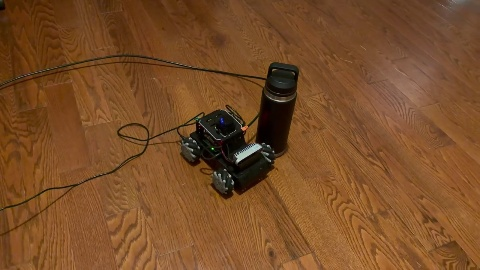
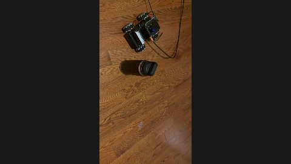
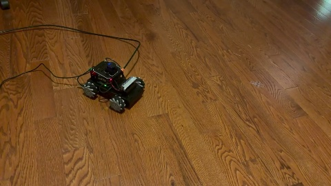
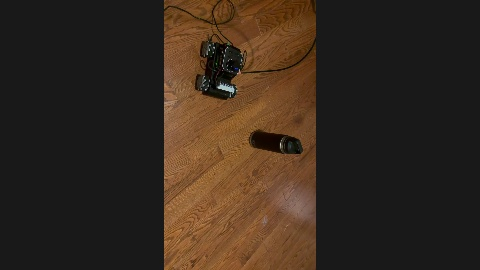

# MentorPi Sim-to-Real Navigation

## Real robot deployment

Four runs on the physical MentorPi, with and without obstacles. All four reached their goals, as confirmed by the operator. Click a thumbnail to watch.

| Trial | Video | Notes |
| --- | --- | --- |
| **1** | [](docs/media/deployment/trial-1.mp4) | Goal reached with an obstacle present. |
| **2** | [](docs/media/deployment/trial-2.mp4) | A second goal-reaching run with an obstacle present. |
| **3 — no obstacle** | [](docs/media/deployment/trial-3.mp4) | Goal reached in open floor space. |
| **4 — left obstacle** | [](docs/media/deployment/trial-4.mp4) | Goal reached with the obstacle placed to the left. |

The goal check uses position, so the robot can arrive sideways. [Original recordings](https://drive.google.com/drive/u/2/folders/1JmySzsq3vORMA3XOVML9RutgsC-31NRy).

## Simulation demo

**Watch MentorPi turn a local map into motion—and reach its goal.**

[](docs/media/mentorpi_goal_demo.mp4)

[Watch the full-resolution video](docs/media/mentorpi_goal_demo.mp4)

The saved neural policy drives the MentorPi through a **seven-obstacle simulation scene**. The cyan trail traces its route, while the side panel shows the live **100 × 100 robot-relative occupancy grid**, remaining goal distance, and simulated time. Each control step reads the map and robot state, infers a motion command, and advances the robot toward the green goal.

The robot reaches the task's **0.15 m arrival threshold after 14.15 simulated seconds**; playback runs at **2× speed**. This is a selected successful rollout (seed 789) using the saved `mentorpi_navigation_best` checkpoint. The scene is rendered in Isaac Sim with the project's analytic planar navigation dynamics; wheel contact physics and camera perception are not simulated in this demo. Aggregate evaluation results are reported below.

Learning-based goal reaching and obstacle avoidance for the Hiwonder MentorPi M1, with Isaac Lab training and a ROS2 deployment stack for Raspberry Pi 5.

## What this project does

- Trains a CNN navigation policy with behavior cloning, DAgger, and PPO.
- Uses a robot-aligned 100 x 100 binary occupancy grid plus relative goal, velocity, and previous action. Commands are forward, lateral, and angular velocity.
- Converts live LiDAR scans to robot-relative occupancy and runs the policy through ROS2.
- Exports policies to TorchScript and ONNX for onboard inference.
- Keeps command expiry, sensor freshness, speed limits, and disarmed startup.

The simulation uses analytic planar motion and swept-disc collision checks inside an Isaac Lab DirectRLEnv. It does not model wheel contact physics. Training observations use ground-truth obstacle geometry; onboard occupancy comes from perception and mapping.

## Results and current status

A selected policy achieved **97.5-98% goal-reaching success across 600 simulated episodes** in the original four-obstacle benchmark (200 episodes each on three held-out seeds). A later deployment-oriented model achieved **98-99.5%** in a separate compound-obstacle simulation benchmark using global-path subgoals. These are separate experiments.

On Raspberry Pi 5, the later TorchScript policy had **5.20 ms p95 inference latency** over 300 calls under the running stack. Numerical export parity, live mapping/localization, and stationary watchdog behavior were checked. **Physical autonomous navigation is still being commissioned; no completed 30-goal hardware trial is claimed.**

See [benchmark results](RESULTS.md).

## Repository layout

| Path | Purpose |
| --- | --- |
| `mentorpi_nav/` | Shared navigation dynamics, observations, networks, and playback |
| `mentorpi_nav/cli/` | Simulation, training, evaluation, viewer, export, and preview commands |
| `mentorpi_nav/robot/` | LiDAR-only ROS input, policy loop, serial bridge, and service commands |
| `mentorpi_nav/media/` | Simulation demo recording and composition |
| `mentorpi_nav/tools/` | SSH transport |
| `scripts/` | Thin Windows launchers for the Python modules |
| `deployment/` | ROS launch adapter, service unit, and active sensor/drivetrain configuration |
| `scenarios/`, `tests/` | Simulation scenarios and existing regression tests |
| `SIMULATION.md` | Detailed simulation commands |

## Setup and usage

The Python code is organized as importable modules. Run commands from the repository root, or install the package in your existing environment with `python -m pip install -e .`. Training uses the Isaac Lab 3 / Newton API installed for the original experiments, along with PyTorch, TensorDict, and RSL-RL. ROS2 Humble and the robot's vendor drivers are needed onboard. The robot mesh/USD assets, simulator installation, trained checkpoints, saved maps, credentials, and generated logs are not included. The four deployment videos above are included.

Use your Isaac Lab Python environment. Copy `local_paths.example.json` to `local_paths.json` and set your local paths if using robot visuals. The USD asset is optional for headless training. PowerShell wrappers accept a local Isaac Lab root; Python entry points can also be called directly.

```powershell
# Check the simulation environment.
.\scripts\run-navigation.ps1 -LabRoot 'C:\path\to\IsaacLab' -TaskArgs @('--mode','smoke','--num-envs','4','--steps','300')

# Train an initial four-obstacle policy.
.\scripts\run-navigation.ps1 -LabRoot 'C:\path\to\IsaacLab' -TaskArgs @('--mode','train','--obstacles','4','--num-envs','8','--iterations','500','--log-dir','logs/grid_obstacles')

# Inspect a checkpoint you have trained.
python -m mentorpi_nav.cli.view --checkpoint logs/grid_obstacles/final.pt

# Evaluate a checkpoint on complete episodes.
python -m mentorpi_nav.cli.evaluate --checkpoint logs/grid_obstacles/final.pt --scenario-file scenarios/original_four.json --seeds 456 789 2026 --episodes 200 --output logs/evaluation

# Run local regression tests in the configured Python environment.
python -m unittest discover -s tests -v
```

Checkpoints must retain their neighboring task/agent manifests. The example training command starts an experiment; reproducing the reported results requires the behavior-cloning/DAgger and PPO training stages, model architecture, scenario settings, and checkpoint selection described in the source and result notes. No pretrained weights are distributed here.

## Robot deployment

The code under `deployment/` targets a particular MentorPi hardware/software stack. Review device names, ROS topics, paths, service files, sensor calibration, and board serial selection for your robot before use.

`scripts/robot-ssh.ps1` expects ignored, locally created connection settings and Windows DPAPI credentials under `.local/`; no credentials are supplied. SSH transport uses Paramiko. Policy export additionally uses ONNX; serial probes use PySerial; observer-camera scripts use OpenCV.

The current prototype uses **LiDAR scan → local occupancy grid**, together with goal, measured velocity, and previous action, to infer body-velocity commands. No saved map or camera is needed in local mode. RF2O LiDAR odometry and IMU-assisted orientation track progress; arrival means within 0.15 m, with no final heading requirement.

On the Pi with this checkout and its updated service installed, run from the repository root and supply a goal in metres (forward, left):

```bash
sudo python3 -m mentorpi_nav.robot --goal-relative 1 0
```

The command starts automatically after model/sensor initialization. Ctrl+C stops it. Optional `--seconds` and `--max-displacement` set run limits; neither has a default cap. Per the prototype configuration, obstacle avoidance is left to the policy: the external collision monitor and distance-stop override are removed. Command/sensor timeouts, speed limits, and the no-measured-motion detector remain. The policy can reverse or stall, and accepting a distant goal does not establish reliable long-range navigation.

Hardware wheel mapping, translation, and turning have been observed. The four videos show operator-confirmed goal arrivals; general obstacle avoidance is not yet established. See [deployment details](ROBOT_DEPLOYMENT.md) and [prototype instructions](AGENTS.md). The obsolete saved-map trial path and one-off deployment probes have been removed; earlier versions remain in Git history.

## References

- [Isaac Lab](https://github.com/isaac-sim/IsaacLab)
- [Hiwonder MentorPi ROS drivers](https://github.com/Hiwonder/MentorPi-ROS)
- [MentorPi asset/starter project](https://github.com/Matzefritz/HiWonder_MentorPi)
- [Nav2](https://github.com/ros-navigation/navigation2)

These external dependencies and assets are not bundled in this repository.
