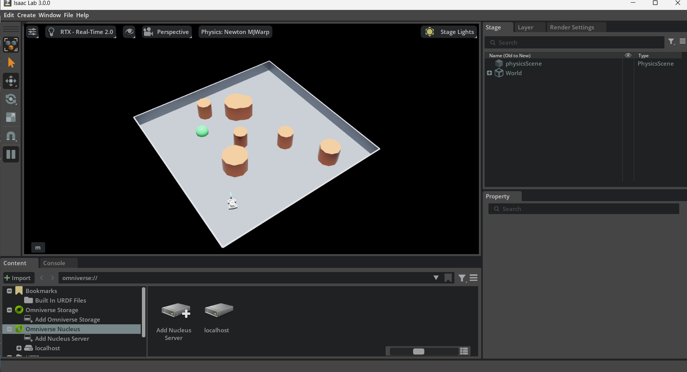
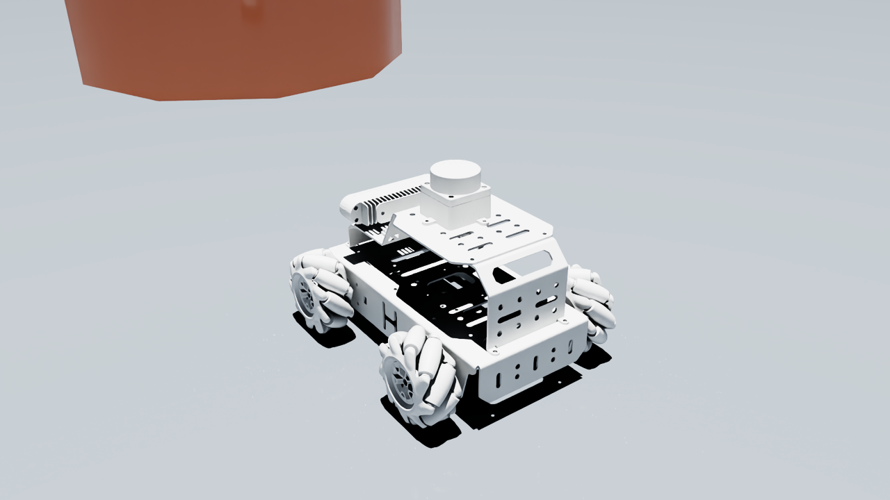
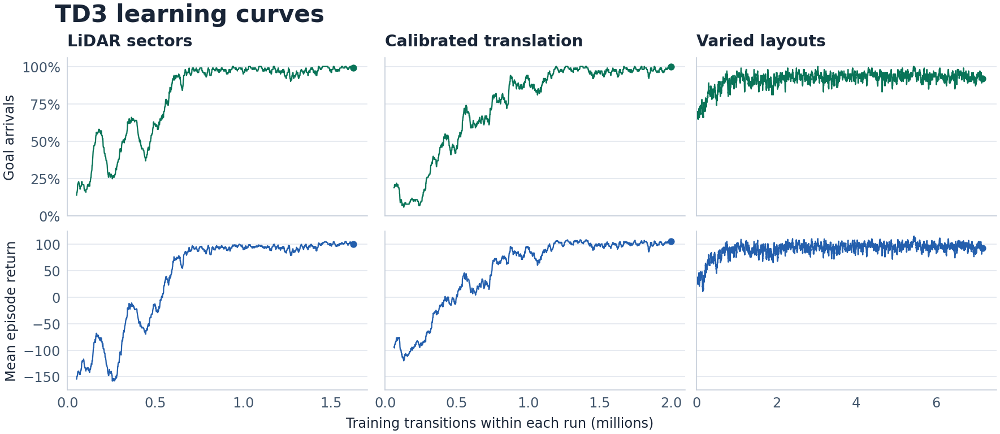

# MentorPi Sim-to-Real Robotics

I'm using reinforcement learning to see how agile I can make a little mecanum robot. The first thing I wanted my Hiwonder MentorPi M1 to learn was how to reach a goal and avoid obstacles using the LiDAR it already had.

## Latest deployment · November 20, 2026

https://github.com/user-attachments/assets/f4524c2c-7724-4369-8b3e-42cf83e94292

**Real robot, left.** I set the goal **1 metre straight ahead of the MentorPi's starting position**. It hesitated at the cardboard doorway, made it through, and reached that goal.

**Simulation, right.** The same **7.15M TD3 policy** reaches a separately placed goal. The green target is offset to the side beyond the simulated doorway, 0.86 m from the start.

The real footage plays at 2× and the replay at 1×. [Full robot take at 1×](docs/media/deployment/2026-11-20/doorway-success.mp4?raw=true) · [Download the comparison](docs/media/simulation/2026-11-20/doorway-sim-to-real.mp4?raw=true)

## How it started

I wanted to try reinforcement learning on a real robot, and I chose Isaac Lab because I'd worked with it before. I imported the MentorPi URDF and built a scene out of simple shapes. Then I had to decide how much of the robot to simulate. A detailed model meant getting the colliders, joints, motor control, and contact between the mecanum rollers and floor right. I'd also have to run enough of those simulations to train on a laptop RTX 2060.

| Original Isaac Lab scene | Imported MentorPi URDF |
| --- | --- |
|  |  |

**Early Isaac Lab rollout.** The policy reaches the green goal while using a local occupancy grid. [MP4](docs/media/mentorpi_goal_demo.mp4?raw=true)

https://github.com/user-attachments/assets/8913a497-2345-4705-b66d-14d11ed62555

I like to start small and iterate. For this first task, I needed the robot to move in a plane, see nearby obstacles, and register a collision when it hit one. The early Isaac demo already used analytic motion. I took that idea further and moved the training loop into a lightweight Python and PyTorch simulator that could raycast LiDAR and check collisions against the same 2D shapes. That let me focus on what the policy could learn from the scan. [2D simulator](docs/planar.md)

## The grid became another thing to get right

My first idea was to turn each LiDAR scan into a 100 × 100 binary map around the robot. A ray cleared the cells it crossed, and hits and unseen areas stayed blocked. It sounded simple until I had to make the simulated grids look like the ones coming off the Pi. I tried randomizing the scan noise and dropped returns, and I still saw the robot get stuck. Each grid-building choice was another thing I had to get right before I could tell what the policy was struggling with. [Simulated and real LiDAR comparison](examples/lidar_sim2real_improvements/)

An early grid policy got the real robot around a bottle and to its goal. The same deployed policy reached the goal in all 150 episodes in one fixed box-and-doorway layout and only 43 of 150 episodes in randomized rooms. After trying more training setups, including PPO with RSL-RL, I wanted to see how much of the preprocessing I could take out. [Original hardware recordings](docs/results.md#onboard-measurements-and-limitations) · [Mixed-shape results](docs/results.md#lightweight-2d-mixed-shape-baseline--november-15-2026)

**Original bottle run.** [MP4](docs/media/deployment/trial-1.mp4?raw=true)

https://github.com/user-attachments/assets/e4f92932-6ad6-46e5-9340-1a3fcb0a9c69

## Borrowing a simpler baseline

I took a step back. What would happen if I started with a navigation method that already worked? I adapted Reinis Cimurs's TD3 implementation. I split the scan into 36 angular sectors and kept the nearest valid return in each. With goal distance, goal bearing, and the previous action, that gave the policy 41 numbers per step. I adapted the actions so the MentorPi could strafe. On the same small room screening set, the first sector policy went from 9 of 40 goal arrivals at 400,000 training transitions to 40 of 40 at about 1.63 million. That gave me a reason to keep working with the simpler input. [Cimurs's reference implementation](https://github.com/reiniscimurs/DRL-robot-navigation) · [Policy interface](docs/planar.md#experimental-laser-sector-td3-policy)

The floor exposed a different problem. Small commands could leave the robot visibly still. I measured how it got moving along each axis, used those measurements to model translation in the simulator, and set commanded yaw to zero for this experiment. Once I had a translation-only policy working in the small rooms, I continued training on a mix of open spaces, boxes, posts, rooms, and narrow doors. I wanted the policy to see a wider range of situations before trying the doorway again. [Motion calibration](docs/calibration.md) · [Training scenario](scenarios/lidar_translation_varied_forever.json)

At the **7.15M** checkpoint, the latest 100 simulated training episodes had 92 goal arrivals, 5 collisions, and 3 timeouts, with a mean return of 92.76. I also replayed that checkpoint without exploration noise in two new doorway layouts. It reached the goal in 8.05 seconds in one and timed out in the other. [Simulated arrival](docs/media/simulation/2026-11-20/doorway-goal.mp4?raw=true)

**Simulated doorway timeout.** The replay shows all 60 simulated seconds at 4× speed. [MP4](docs/media/simulation/2026-11-20/doorway-timeout.mp4?raw=true)

https://github.com/user-attachments/assets/1423a459-b742-45c5-9b75-7f05a563b230

See the TD3 training curves

Each curve uses the latest 100 completed training episodes with exploration noise. The horizontal axis counts transitions within each run. The varied-layout run starts from an earlier checkpoint.

## What happened on the floor

I set up a gap roughly twice the robot's width and put the 7.15M policy on the Pi.

**Goal arrival with cord contact.** [MP4](docs/media/deployment/2026-11-20/goal-with-cord-contact.mp4?raw=true)

https://github.com/user-attachments/assets/47b30884-a82b-46e2-bd33-a2fb1ad7d25e

I also recorded collisions and a hardware failure. I saw the robot keep moving after a connection interruption and don't know when the last command reached it. The seven recordings are exploratory takes, so I don't have a reliable doorway success rate yet. [Collision example](docs/media/deployment/2026-11-20/collision-1.mp4?raw=true) · [All seven takes](docs/results.md#doorway-replays-and-real-deployment--november-20-2026)

**Back-and-forth failure.** [MP4](docs/media/deployment/2026-11-20/back-and-forth.mp4?raw=true)

https://github.com/user-attachments/assets/09cf3be5-6e01-464d-9647-d0bd3770f158

In one logged run, the policy kept reversing its commands while LiDAR odometry measured about 2 mm of net travel. I wonder if, in a tight spot, the reward makes it easier for the policy to wait out the episode than risk a collision. I've also seen a steady diagonal command barely move the chassis from rest. The next thing I want to see is the robot making the same doorway pass reliably.

## Explore the project

[Simulation and training](docs/simulation.md) · [Robot deployment](docs/deployment.md) · [Results](docs/results.md) · [Task roadmap](docs/roadmap.md)
