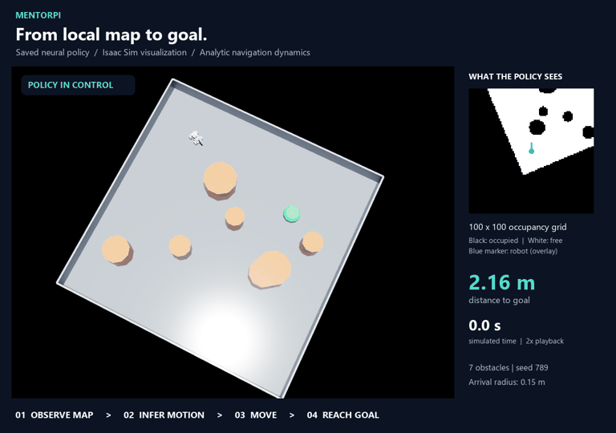

# MentorPi Sim-to-Real Robotics

Learning robot behaviors in simulation and transferring them to a physical Hiwonder MentorPi M1. The project started in Isaac Lab and now trains its LiDAR navigation policy in a lightweight 2D Python simulator. The real robot runs inference and mecanum drive control on a Raspberry Pi.

**Task 01 is goal-conditioned navigation with obstacle avoidance.** It is the first step in a broader series of sim-to-real tasks covering changing surfaces, vehicle dynamics, perception and increasingly complex movement.

## 1. Simulation: learning to reach a goal

[](docs/media/mentorpi_goal_demo.mp4)

[Watch the full-resolution simulation](docs/media/mentorpi_goal_demo.mp4)

The policy drives toward the green goal while observing a robot-relative occupancy grid. The display shows the route, local grid and remaining goal distance. This rollout reaches the 0.15 m arrival threshold in 14.15 simulated seconds; the animation plays at 2× speed.

Training uses behavior cloning, DAgger and PPO. The displayed simulation uses analytic planar dynamics inside Isaac Sim; wheel-ground contact and rendered sensors are not part of this experiment.

## 2. Real robot: around an obstacle

https://github.com/user-attachments/assets/e4f92932-6ad6-46e5-9340-1a3fcb0a9c69

**Trial 1:** the real MentorPi moves around the bottle and reaches its goal, as confirmed by the operator. The goal specifies position, so arrival does not require the robot to face forward.

[Download Trial 1](docs/media/deployment/trial-1.mp4) · [Additional recordings](docs/media/deployment/)

## How the project evolved

### From Isaac Lab to a 2D simulator

I started this project because Isaac Lab looked cool and I wanted to try reinforcement learning on a real robot. I brought in the MentorPi URDF, built a scene with simple obstacles, and set a first task I could measure. Could the robot learn to reach a goal using the LiDAR it already had?

My approach is to start small and iterate. A detailed simulation would mean tuning wheel joints, colliders, motor control, and ground contact for mecanum rollers, then running enough rollouts to train on a laptop RTX 2060. The first task only needed a robot that could move in a plane, sense nearby obstacles, and collide with them. I moved training into a Python and PyTorch simulator that raycasts LiDAR against 2D geometry and uses a simple mecanum motion model.

### From occupancy grids to LiDAR sectors

My first LiDAR policy used a 100 × 100 local occupancy grid built from each scan. Building the grid added a preprocessing step I had to match between simulation and hardware. I experimented with simulated scan noise and dropouts, and I still saw the robot get stuck in some trials. The grid-based approach did reach goals in simulation and on hardware, including the bottle run above. The earlier occupancy-grid benchmark reported 97.5–98% goal arrivals across three held-out four-obstacle evaluations of 200 episodes each. [Evaluation results](docs/results.md)

After trying several training setups, including PPO with RSL-RL, I looked for a simpler observation design and adapted Reinis Cimurs’s TD3 navigation implementation. I split the current scan into 36 angular sectors and kept the nearest valid return in each. The policy sees those distances, the goal distance and bearing, and its previous three action values. That’s 41 numbers. I adapted the action space for the MentorPi so it can strafe. The checkpoint below was trained for translation with yaw held at zero. [Reference implementation](https://github.com/reiniscimurs/DRL-robot-navigation) · [2D LiDAR simulator](docs/planar.md)

```text
Simulated LiDAR / live LiDAR
                ↓
     36 nearest-return sectors
                + goal distance and bearing, previous action
                ↓
         learned navigation policy
                ↓
       body velocity → wheel commands
```

### Hardware update · November 20, 2026

At the `model_7150000.pt` checkpoint, the latest 100 simulated **training** episodes included 92 goal arrivals, 5 collisions, and 3 timeouts. Mean episode return was 92.76. These rollouts used exploration noise. A fixed set of held-out scenes and seeds would let me compare checkpoints under the same conditions.

I deployed the checkpoint as `7.15m` and tried it on a wall with a gap about twice the robot’s width, similar to a scene in simulation. Some runs reached the goal. I also saw glancing contact and movement continue after a connection interruption. I don’t know exactly when commands stopped reaching the robot during those runs. These were exploratory trials, and I don’t have a reliable hardware success rate for the doorway yet.

In one logged run, the policy repeatedly reversed direction while LiDAR odometry measured only about 2 mm of net travel. The controller disarmed after detecting commands without measured motion. I wondered whether the reward made it too easy to wait out an episode. That’s still a hypothesis. An earlier run barely moved even with a steady diagonal command, so I also need to check how the chassis responds to commands from rest. My next milestone is getting consistent behavior through the same doorway.

## Next tasks

| Task | What we want the robot to learn | Status |
| --- | --- | --- |
| **01 · Obstacle navigation** | Reach a selected position using local obstacle observations. | Initial simulation-to-hardware demonstration |
| **02 · Different-friction surfaces** | Drive across wood, tile, carpet and rubber, including transitions between surfaces. | Planned |
| **03 · Slip and disturbance recovery** | Recover from wheel slip, sideways drift and small external disturbances. | Planned |
| **04 · Payload adaptation** | Maintain motion accuracy as carried mass and load distribution change. | Planned |
| **05 · Constrained-space motion** | Strafe through narrow gaps, negotiate corners and park in tight spaces. | Planned |
| **06 · Moving obstacles** | Adjust the route or yield when obstacles enter the path. | Planned |
| **07 · Robust perception** | Handle LiDAR noise, occlusion, dropped returns and sensing delay. | Planned |
| **08 · Pose-accurate docking** | Reach a docking pose with both position and heading constraints. | Planned |
| **09 · Multi-goal missions** | Complete waypoint sequences while managing accumulated odometry error. | Planned |

Future tasks will extend the dynamics and sensing models as needed, then compare simulation and hardware behavior. In particular, friction and slip studies will add wheel-ground dynamics beyond the current analytic model. [Task roadmap](docs/roadmap.md).

## Run the project

Use a Python environment with the planar dependencies for 2D simulation and the configured ROS2 Humble container on the robot. The existing Isaac Lab Python environment also has the planar dependencies. Trained weights and third-party robot assets are not bundled. [Local setup](docs/planar.md)

```bash
# Inspect or evaluate a trained checkpoint.
python -m mentorpi_nav.cli.view --checkpoint path/to/final.pt
python -m mentorpi_nav.cli.evaluate --checkpoint path/to/final.pt --output logs/evaluation

# On the configured Pi, from the repository root: goal 1 metre forward.
sudo python3 -m mentorpi_nav.robot --goal-relative 1 0
```

## Documentation and code

| Resource | Contents |
| --- | --- |
| [Simulation](docs/simulation.md) | Training, evaluation, playback and policy input contract |
| [Robot deployment](docs/deployment.md) | ROS modules, installation, goals and motor interface |
| [Results](docs/results.md) | Benchmark counts, inference measurements and evidence |
| [Roadmap](docs/roadmap.md) | Planned robot tasks and experiment objectives |
| [Agent instructions](AGENTS.md) | Code ownership and sim-to-real engineering conventions |

Shared dynamics and policy code live in `mentorpi_nav/`; executable modules are grouped under `cli/`, `robot/`, `media/` and `tools/`. Windows launchers are in `scripts/`, robot configuration in `deployment/`, and task scenarios in `scenarios/`.
