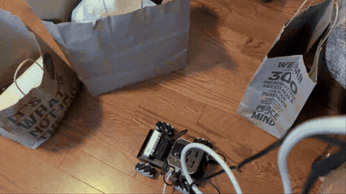

# MentorPi Isaac Lab

We trained a PPO navigation policy entirely in Isaac Lab using Newton physics, then deployed it to a physical Hiwonder MentorPi M1. In this run, the robot used LiDAR and onboard state estimates to steer around obstacles and reach its goal.



[Watch the full real-world recording](videos/day-2-real-world-navigation-success.mp4)

This project is open to collaboration. Open an issue or pull request with simulation improvements, training results, or hardware tests.

## Install

Install [uv](https://docs.astral.sh/uv/getting-started/installation/) and Python 3.12. Use a machine with a CUDA-capable NVIDIA GPU for training. This project expects Isaac Lab to be a sibling checkout named `IsaacLab`. From the directory that contains this repository, run:

```sh
git clone https://github.com/isaac-sim/IsaacLab.git
git -C IsaacLab checkout 6e2c6d427a4439c726c08ac4d003e77cb9bfa845
```

From this repository's root, install the dependencies and confirm the task is registered:

```sh
uv sync --extra video
uv run --extra video isaaclab list_envs --keyword MentorpiIsaaclab
```

## Train and run

Train the MentorPi task with RSL-RL:

```sh
uv run --extra video isaaclab train --rl_library rsl_rl --task MentorpiIsaaclab-Balance-Mentorpi --num_envs 256 --viz none
```

Play the latest local checkpoint in one environment and record a clip:

```sh
uv run --extra video isaaclab play --rl_library rsl_rl --task MentorpiIsaaclab-Balance-Mentorpi --checkpoint latest --num_envs 1 --video viz:newton --video_length 1200
```

Checkpoints are saved under `logs/rsl_rl/mentorpi_motion/`. The recording goes in `videos/play/` inside the checkpoint's run directory. To replay a specific checkpoint, replace `latest` with its `model_*.pt` path.

## Project docs

- [Sim-to-real policy](docs/sim-to-real/policy.md)
- [Training and hardware trials](docs/sim-to-real/trials.md)
- [MentorPi deployment guide](deployment/README.md)
