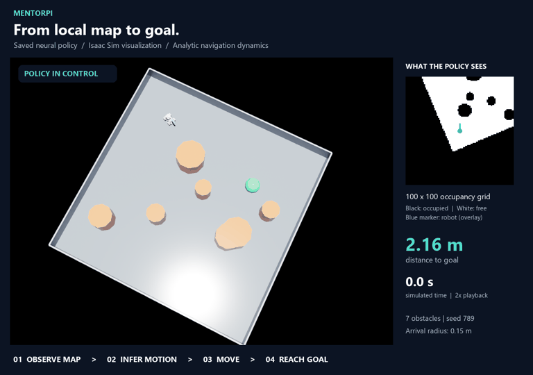

# MentorPi Sim-to-Real Navigation

**Watch MentorPi turn a local map into motion—and reach its goal.**

[](docs/media/mentorpi_goal_demo.mp4)

[Watch the full-resolution video](docs/media/mentorpi_goal_demo.mp4)

The saved neural policy drives the MentorPi through a **seven-obstacle simulation scene**. The cyan trail traces its route, while the side panel shows the live **100 × 100 robot-relative occupancy grid**, remaining goal distance, and simulated time. Each control step reads the map and robot state, infers a motion command, and advances the robot toward the green goal.

The robot reaches the task's **0.15 m arrival threshold after 14.15 simulated seconds**; playback runs at **2× speed**. This is a selected successful rollout (seed 789) using the saved `mentorpi_navigation_best` checkpoint. The scene is rendered in Isaac Sim with the project's analytic planar navigation dynamics; wheel contact physics and camera perception are not simulated in this demo. Aggregate evaluation results are reported below.

Learning-based goal reaching and obstacle avoidance for the Hiwonder MentorPi M1, with Isaac Lab training and a ROS2 deployment stack for Raspberry Pi 5.

## What this project does

- Trains a CNN navigation policy with behavior cloning, DAgger, and PPO.
- Uses a robot-aligned 100 x 100 binary occupancy grid plus relative goal, velocity, and previous action. Commands are forward, lateral, and angular velocity.
- Integrates LiDAR/depth mapping, localization, Nav2 global paths, and a learned local controller through ROS2.
- Exports policies to TorchScript and ONNX for onboard inference.
- Includes command expiry, sensor-health checks, disarmed startup, and a physical commissioning gate.

The simulation uses analytic planar motion and swept-disc collision checks inside an Isaac Lab DirectRLEnv. It does not model wheel contact physics. Training observations use ground-truth obstacle geometry; onboard occupancy comes from perception and mapping.

## Results and current status

A selected policy achieved **97.5-98% goal-reaching success across 600 simulated episodes** in the original four-obstacle benchmark (200 episodes each on three held-out seeds). A later deployment-oriented model achieved **98-99.5%** in a separate compound-obstacle simulation benchmark using global-path subgoals. These are separate experiments.

On Raspberry Pi 5, the later TorchScript policy had **5.20 ms p95 inference latency** over 300 calls under the running stack. Numerical export parity, live mapping/localization, and stationary watchdog behavior were checked. **Physical autonomous navigation is still being commissioned; no completed 30-goal hardware trial is claimed.**

See [benchmark results](RESULTS.md) and [historical experiment counts](navigation_goal_results.csv).

## Repository layout

| Path | Purpose |
| --- | --- |
| `mentorpi_nav/` | Navigation dynamics, observations, networks, training environment, teacher, evaluation, and playback |
| `scenarios/` | Obstacle layouts and motion uncertainty configurations |
| `deployment/runtime/` | ROS2 perception, navigation, hardware bridge, and command guards |
| `deployment/config/` | SLAM, localization, planning, and collision-monitor configuration |
| `deployment/export_policy.py` | TorchScript / ONNX export and parity checks |
| `tests/`, `deployment/tests/` | Behavior, model-contract, and deployment regression tests |
| `SIMULATION.md` | Detailed simulation interface and experiment commands |

## Setup and usage

This is a research workspace, not a standalone packaged application. Training uses the Isaac Lab 3 / Newton API installed for the original experiments, along with PyTorch, TensorDict, and RSL-RL. ROS2 Humble and the robot's vendor drivers are needed onboard. The robot mesh/USD assets, simulator installation, trained checkpoints, maps, robot recordings, credentials, and generated logs are not included.

Use your Isaac Lab Python environment. Copy `local_paths.example.json` to `local_paths.json` and set your local paths if using robot visuals. The USD asset is optional for headless training. PowerShell wrappers accept a local Isaac Lab root; Python entry points can also be called directly.

```powershell
# Check the simulation environment.
.\run-navigation.ps1 -LabRoot 'C:\path\to\IsaacLab' -TaskArgs @('--mode','smoke','--num-envs','4','--steps','300')

# Train an initial four-obstacle policy.
.\run-navigation.ps1 -LabRoot 'C:\path\to\IsaacLab' -TaskArgs @('--mode','train','--obstacles','4','--num-envs','8','--iterations','500','--log-dir','logs/grid_obstacles')

# Inspect a checkpoint you have trained.
python view_navigation.py --checkpoint logs/grid_obstacles/final.pt

# Evaluate a checkpoint on complete episodes.
python evaluate_suite.py --checkpoint logs/grid_obstacles/final.pt --scenario-file scenarios/original_four.json --seeds 456 789 2026 --episodes 200 --output logs/evaluation

# Run local regression tests in the configured Python environment.
python -m unittest discover -s tests -v
```

Checkpoints must retain their neighboring task/agent manifests. The example training command starts an experiment; reproducing the reported results requires the behavior-cloning/DAgger and PPO training stages, model architecture, scenario settings, and checkpoint selection described in the source and result notes. No pretrained weights are distributed here.

## Robot deployment

The code under `deployment/` targets a particular MentorPi hardware/software stack. Review device names, ROS topics, paths, service files, sensor calibration, and board serial selection for your robot before use. `direct_motor_probe.py` deliberately contains a placeholder board serial.

`robot-ssh.ps1` expects ignored, locally created connection settings and Windows DPAPI credentials under `.local/`; no credentials are supplied. SSH transport uses Paramiko. Policy export additionally uses ONNX; serial probes use PySerial; observer-camera scripts use OpenCV.

Runtime startup is disarmed. Autonomous trial start requires a commissioning acceptance artifact, valid localization, fresh sensors, and explicit arming. Hardware motion and end-to-end navigation remain unvalidated. The learned policy is not a general safety controller.

## References

- [Isaac Lab](https://github.com/isaac-sim/IsaacLab)
- [Hiwonder MentorPi ROS drivers](https://github.com/Hiwonder/MentorPi-ROS)
- [MentorPi asset/starter project](https://github.com/Matzefritz/HiWonder_MentorPi)
- [Nav2](https://github.com/ros-navigation/navigation2)

These external dependencies and assets are not bundled in this repository.
