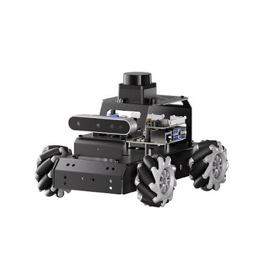
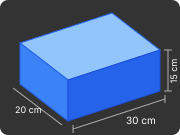
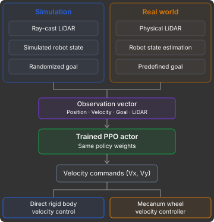
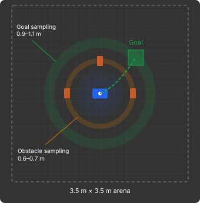
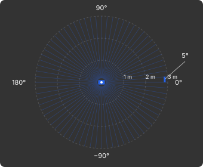
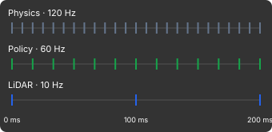
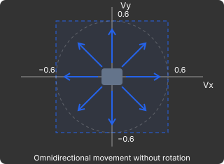
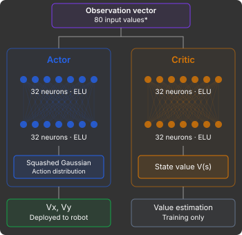
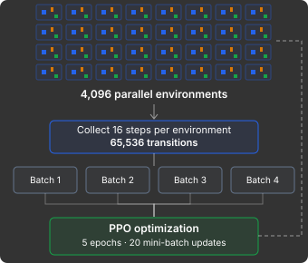
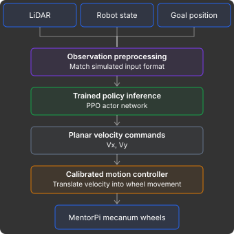

# Sim-to-real navigation policy

[Repository quick start](../../README.md) · [Training and hardware trials](trials.md)

## **Introduction**

While looking online, I couldn't find anyone using the $430 [MentorPi M1](https://www.hiwonder.com/products/mentorpi-m1?variant=41285786796119\&utm_source=chatgpt.com) robot in Isaac Lab. The robot has mecanum wheels, allowing it to move in any direction without needing to change its orientation.

Given the success and growing popularity of robotic simulation tools, I wanted to challenge myself to start from scratch and train a navigation policy that could avoid obstacles and reach a predefined goal in my house.

I know what you're thinking: why train an RL policy at all? There are certainly more traditional ways to solve this problem, but I wanted to improve my skills in reinforcement learning and sim-to-real transfer while giving myself an extra challenge.

| Physical MentorPi M1 | Simulated MentorPi |
| :---: | :---: |
|  |  |

## **Current progress**

- Developed a custom reinforcement learning environment in Isaac Lab using the Newton physics backend.
- Trained a lightweight PPO navigation policy entirely in simulation.
- Identified and addressed several sim-to-real discrepancies through iterative experimentation.
- Successfully deployed the trained policy to the physical MentorPi.
- Demonstrated real-world obstacle avoidance without additional real-world policy training.

## **System architecture**

The goal of this project was to train a high-level navigation policy rather than a low-level motor controller.

The same trained policy receives equivalent observations from either the simulated or physical environment and outputs two continuous velocity commands.

Sim-to-real architecture. The physical deployment pipeline is shown conceptually pending documentation of its implementation.

## **Creating the simulation environment**

I wanted to start as simple as possible and increase the complexity of the simulation only when it became necessary. This allowed me to understand each component of the system as the project scaled.

Rather than creating a detailed simulation of the MentorPi's motors, wheels, and chassis, I represented the robot as a simple rigid cuboid with approximately the same dimensions as the physical robot.

The simulation directly controls the robot's planar velocity while maintaining a fixed orientation.

### **Simulation vs. real world**

| Component        | Simulation                          | Real world                                            |
| ---------------- | ----------------------------------- | ----------------------------------------------------- |
| Robot geometry   | 30 × 20 × 15 cm cuboid              | MentorPi chassis                                      |
| Mass             | 1 kg                                | TODO                                                  |
| LiDAR            | 360° ray-cast sensor, 5° resolution | Physical LiDAR measurements grouped into 5° intervals |
| Robot state      | Simulated position and velocity     | Onboard state estimation                              |
| Obstacles        | Three randomized cuboids            | Physical obstacles                                    |
| Goal             | Randomized, 0.9–1.1 m away          | Predefined goal 1 m away                              |
| Velocity control | Direct rigid body velocity          | Calibrated mecanum wheel controller                   |
| Action space     | X and Y velocity                    | X and Y velocity                                      |
| Rotation         | Fixed orientation                   | Rotation excluded                                     |

The MentorPi is capable of rotating, but due to limitations in its existing rotational motion calibration, I excluded rotation from this project.

### **Environment randomization**

At the beginning of each episode, three obstacles are placed around the robot. The obstacle arrangement is randomly rotated, and each obstacle's distance from the robot is sampled independently.

The goal is also randomized around the robot, outside the obstacle sampling region.

| Parameter           | Value                  |
| ------------------- | ---------------------- |
| Arena dimensions    | 3.5 × 3.5 m            |
| Number of obstacles | 3                      |
| Obstacle dimensions | 11.7 × 20 × 6.7 cm     |
| Obstacle distance   | 0.6–0.7 m              |
| Goal distance       | 0.9–1.1 m              |
| Goal dimensions     | 30 × 30 cm             |
| Goal direction      | Randomized across 360° |

An episode terminates when the robot reaches the goal, collides with an obstacle, leaves the arena, or exceeds the episode time limit.

## **Observation space**

The policy receives a concatenated observation vector consisting of the robot's position, linear velocity, relative goal position, and LiDAR measurements.

| Observation     | Dimensions | Description                            |
| --------------- | ---------- | -------------------------------------- |
| Position        | 3          | Robot XYZ position                     |
| Linear velocity | 3          | Robot XYZ velocity                     |
| Goal offset     | 2          | XY displacement from robot to goal     |
| LiDAR           | 72\*       | Distance measurements around the robot |
| **Total**       | **80**\*   |                                        |

\*Expected dimensions based on the LiDAR configuration. Exact runtime tensor dimensions are pending verification.

### **LiDAR**

The simulated LiDAR uses a single horizontal channel with a full 360° field of view.

| Field of view | Maximum range | Update rate |
| --- | --- | --- |
| 360° | 3 m | 10 Hz |

Missing LiDAR returns are replaced with the maximum sensor range. The physical LiDAR measurements are grouped into corresponding angular intervals to match the simulated observation format.

Observation corruption and normalization are currently disabled.

### **Simulation and sensor frequencies**

The simulation runs at 120 Hz, the policy operates at 60 Hz, and the simulated LiDAR updates at 10 Hz.

Approximately six policy updates occur between LiDAR scans.

## **Action space**

The policy produces two continuous outputs corresponding to the desired planar velocity of the robot.

$$
a_t=[v_x,v_y]
$$

Each velocity component is bounded independently:

$$
-0.6\leq v_x,v_y\leq 0.6\text{ m/s}
$$

The current policy uses a squashed Gaussian action distribution to constrain sampled actions during training. The environment also clamps the resulting velocities as an additional safeguard.

The simulated robot's orientation is maintained at its spawn orientation, and its angular velocity is set to zero.

## **Reinforcement learning architecture**

The navigation policy is trained using Proximal Policy Optimization (PPO) through RSL-RL.

Both the actor and critic are lightweight multilayer perceptrons with two hidden layers of 32 neurons and ELU activation functions.

The actor's mean-output network contains approximately 3,714 trainable parameters, assuming an 80-dimensional observation space. This makes it a lightweight policy suitable for embedded robotic applications.

### **Parallel training**

Isaac Lab allows thousands of environments to be simulated simultaneously, collecting experience for the policy to learn from.

Parallel training pipeline using the default environment configuration.

### **Training configuration**

| Parameter                         | Value           |
| --------------------------------- | --------------- |
| Simulation framework              | Isaac Lab 3.0   |
| Physics backend                   | Newton MJWarp   |
| RL algorithm                      | PPO             |
| RL library                        | RSL-RL          |
| Parallel environments             | 4,096 (default) |
| Physics timestep                  | 1/120 s         |
| Action decimation                 | 2               |
| Maximum episode length            | 200 s           |
| Actor hidden layers               | [32, 32]        |
| Critic hidden layers              | [32, 32]        |
| Activation                        | ELU             |
| Learning rate                     | 3e-4            |
| Learning rate schedule            | Fixed           |
| Discount factor                   | 0.99            |
| GAE lambda                        | 0.95            |
| PPO clipping parameter            | 0.2             |
| Entropy coefficient               | 0.001           |
| Value loss coefficient            | 1.0             |
| Initial action standard deviation | 0.35            |
| Action standard deviation range   | 0.05–0.75       |
| Steps per environment             | 16              |
| Learning epochs                   | 5               |
| Mini-batches                      | 4               |
| Maximum gradient norm             | 1.0             |
| Desired KL divergence             | 0.01            |
| Default training iterations       | 150             |
| Training hardware                 | TODO            |
| Training duration                 | TODO            |

These are the current default configurations. Individual experiments used different training settings.

## **Deployment pipeline**

Conceptual real-world inference pipeline.

The physical deployment relies on the MentorPi's existing motion controller to translate the planar velocity commands into individual mecanum wheel movements.

The following deployment details will be documented:

| Component                      | Implementation |
| ------------------------------ | -------------- |
| Inference hardware             | TODO           |
| Policy export format           | TODO           |
| ROS2 topics                    | TODO           |
| Localization                   | TODO           |
| LiDAR preprocessing            | TODO           |
| Real-world inference frequency | TODO           |
| Velocity calibration           | TODO           |
| Safety and stopping conditions | TODO           |

## **Future work**

- Increase the number and variety of obstacles in the simulation.
- Randomize obstacle dimensions and orientations.
- Introduce LiDAR noise, latency, and missing measurements.
- Randomize actuator response and velocity tracking errors.
- Investigate asymmetric movement on the physical robot.
- Improve the robot's motion calibration.
- Experiment with larger simulated collision footprints.
- Introduce rotational movement.
- Evaluate the policy across a larger number of real-world environments.
- Compare simulated and physical trajectories quantitatively.

The overall goal is to move beyond transferring a policy for a single controlled scenario and toward a robust navigation policy that can operate across a wider variety of real-world environments.

## **Acknowledgments**

This project was developed using the following open-source robotics and reinforcement learning tools:

- [Isaac Lab](https://github.com/isaac-sim/IsaacLab?utm_source=chatgpt.com)
- [Newton](https://github.com/newton-physics/newton?utm_source=chatgpt.com)
- [RSL-RL](https://github.com/leggedrobotics/rsl_rl?utm_source=chatgpt.com)
- [ROS2](https://www.ros.org/?utm_source=chatgpt.com)
