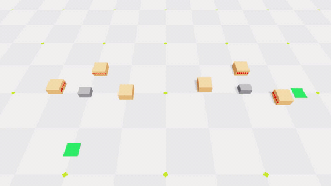
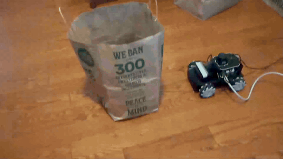
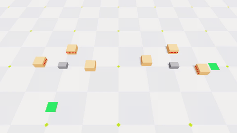
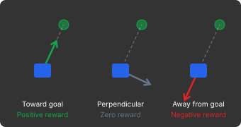
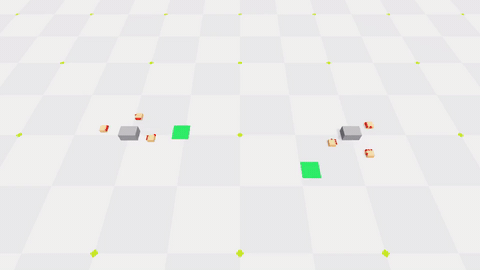
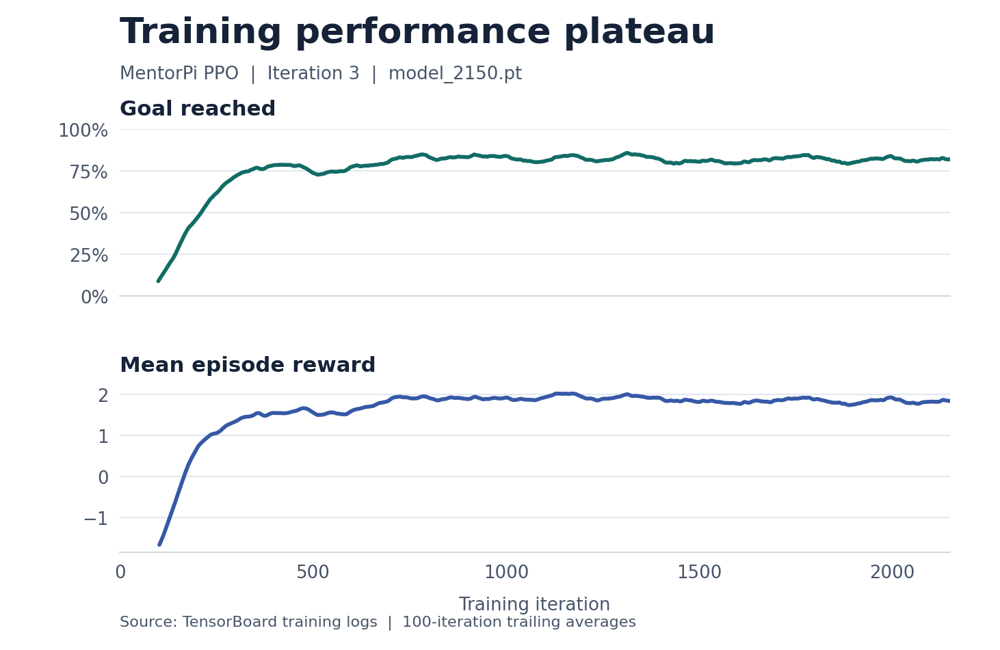
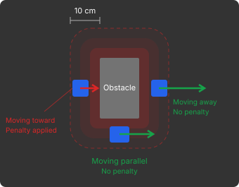
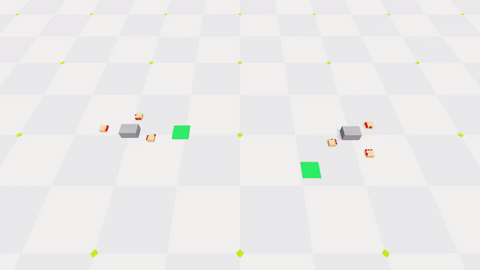
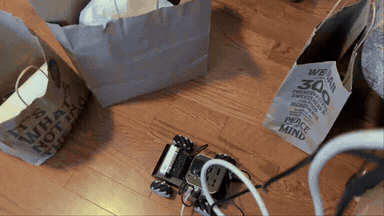
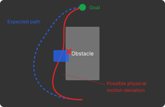

# Training and hardware trials

[Repository quick start](../../README.md) · [Sim-to-real policy](policy.md)

## **Training and experimentation**

Each simulation recording shows two environments for 40 seconds at the same camera angle. For these replays, episode timeouts are 10 seconds, or 20 seconds for the reduced-speed policy, to show fresh attempts within the clip.

### **Iteration #1 — Training the initial policy**

As I created the first setup for this project, I iterated on the reward functions until the simulation trained a good policy.

The results looked great! Training was fast, and the success rate in simulation was nearly 100%.

Checkpoint: [`model_900.pt`](../../checkpoints/initial-policy/model_900.pt) · [Description and playback](../../checkpoints/initial-policy/README.md).

[Full recording](../../videos/iteration-1-sim-navigation-success.mp4)

The initial reward function consisted of four terms.

| Reward term        | Weight | Description                              |
| ------------------ | ------ | ---------------------------------------- |
| `progress`         | +1.0   | Signed velocity toward the goal          |
| `distance_to_goal` | −0.1   | Penalizes remaining distance to the goal |
| `reached_goal`     | +60.0  | Successfully reaching the goal           |
| `failure`          | −120.0 | Collision or leaving the arena           |

But when I deployed the policy to the real robot...

[Full recording](../../videos/d1_col_4.mp4)

The robot repeatedly collided with obstacles that the simulated policy was able to avoid.

Despite the high success rate in simulation, the policy did not successfully transfer to the real world.

### **Iteration #2 — Identifying the velocity gap**

Why was the policy running into obstacles in the real world when it wasn't in simulation?

After comparing the behavior of the two robots, I realized that the simulated robot was moving much faster than the physical MentorPi. This made me think the real robot's policy was telling the robot to execute much higher speeds than it could, thinking it woulld clear the obstable but really it was just moving at a limited speed. I confirmed this by checking the output logs of the policy and the limits online of the Mentorpi.
The policy outputs were capped at 1m/s and the mentorpi had a cap of .6m/s.

To reduce this discrepancy, I introduced velocity limits to the simulation.

Great, now that the simulated robot moves more like the real robot, everything should still work in simulation, right?

[Full recording](../../videos/iteration-2-sim-velocity-limit-hesitation.mp4)

Unfortunately, reducing the velocity introduced a new problem. The policy became hesitant and struggled to consistently reach the goal.

The reward function that previously worked well was no longer effective under the reduced velocity constraints.

### **Iteration #3 — Adjusting the progress reward**

After introducing velocity limits, the robot was unable to achieve the same magnitude of progress reward that it received at higher velocities.

The fix? Increase the reward for moving toward the goal.

The progress reward is calculated by projecting the robot's velocity onto the normalized direction of the goal.

$$
r_{\text{progress}}= w_p(\vec v\cdot\hat g)
$$

Where:

- $\vec v$ is the robot's planar velocity.
- $\hat g$ is the normalized direction toward the goal.
- $w_p$ is the progress reward weight.

I doubled the weight of the progress reward from 1.0 to 2.0.

| Reward term        | Previous weight | New weight |
| ------------------ | --------------- | ---------- |
| `progress`         | 1.0             | **2.0**    |
| `distance_to_goal` | −0.1            | −0.1       |
| `reached_goal`     | 60.0            | 60.0       |
| `failure`          | −120.0          | −120.0     |

Checkpoint: [`model_2150.pt`](../../checkpoints/progress-reward/model_2150.pt) · [Description and playback](../../checkpoints/progress-reward/README.md).

[Full recording](../../videos/iteration-3-sim-progress-reward.mp4)

Great! The simulated robot was once again reaching the goal after training.

However, there was still another problem.

### **Iteration #4 — Teaching obstacle clearance**

After training for a longer period of time, the simulated robot was still colliding with obstacles approximately 18% of the time.

The policy appeared to have reached a performance plateau, and additional training under the existing reward configuration was not consistently improving its success rate.

Why would the policy learn this behavior?

The existing reward function encouraged movement toward the goal and heavily penalized collisions, but it did not provide an explicit signal discouraging dangerous movement near obstacles before a collision occurred.

The policy was essentially learning to avoid obstacles through trial and error, without receiving additional guidance about how close it could safely approach them.

#### **The fix: a directional obstacle clearance penalty**

I introduced a new reward term that created what I like to call a **ring of pain** around each obstacle.

When the robot enters this region, it receives an increasingly large penalty for moving toward the obstacle as the clearance decreases.

However, simply being near an obstacle does not result in a penalty. The robot can still move alongside an obstacle or move away from it without being penalized by this reward term.

The clearance penalty depends on both distance and direction of movement.

The reward is calculated using the shortest separation between the robot's rectangular footprint and the obstacle's footprint.

A 10 cm clearance margin defines the region in which the penalty becomes active.

The proximity multiplier is calculated using a smoothstep function:

$$
p_i=\operatorname{clamp} \left(1-\frac{d_i}{0.10},0,1\right)
$$

$$
s_i=p_i^2(3-2p_i)
$$

This multiplier is combined with the robot's closing velocity toward the obstacle:

$$
r_{\text{clearance}}= -2.0\max_i\left[ s_i\max(0,\vec v\cdot\hat n_i) \right]
$$

Where $d_i$ is the footprint clearance and $\hat n_i$ is the direction toward obstacle $i$.

#### **Obstacle clearance reward example**

At the illustrated closing velocity of 0.60 m/s, the reward is −1.20 at zero clearance and −0.60 at 5 cm before environment timestep scaling.

By penalizing closing velocity rather than proximity alone, the policy receives guidance to avoid dangerous movements without unnecessarily discouraging movement alongside obstacles.

#### **Final reward function**

| Reward term          | Weight | Description                                          |
| -------------------- | ------ | ---------------------------------------------------- |
| `progress`           | +2.0   | Signed velocity toward the goal                      |
| `distance_to_goal`   | −0.1   | Bounded exponential distance cost                    |
| `obstacle_clearance` | −2.0   | Proximity-weighted closing velocity toward obstacles |
| `reached_goal`       | +60.0  | Successfully reaching the goal                       |
| `failure`            | −120.0 | Collision or leaving the arena                       |

The distance-to-goal cost is calculated as:

$$
c_{\text{distance}}= \exp\left(\frac{\min(d_g,2.5)}{2}\right)-1
$$

This increases the cost of being farther away from the goal while bounding its maximum value.

[Full recording](../../videos/iteration-4-sim-obstacle-clearance.mp4)

This worked! The policy learned to navigate around obstacles and reach the goal while operating under the reduced velocity constraints.

### **Experiment summary**

| Iteration | Change                        | Result                                                         |
| --------- | ----------------------------- | -------------------------------------------------------------- |
| #1        | Initial navigation policy     | Near 100% simulated success, poor real-world transfer          |
| #2        | Velocity constraints          | Hesitant movement and reduced simulated performance            |
| #3        | Doubled progress reward       | Improved goal-directed movement                                |
| #4        | Directional clearance penalty | Improved obstacle avoidance and successful real-world transfer |

| Reward             | #1   | #2   | #3   | #4   |
| ------------------ | ---- | ---- | ---- | ---- |
| Progress           | 1.0  | 1.0  | 2.0  | 2.0  |
| Distance to goal   | −0.1 | −0.1 | −0.1 | −0.1 |
| Reached goal       | 60   | 60   | 60   | 60   |
| Failure            | −120 | −120 | −120 | −120 |
| Obstacle clearance | —    | —    | —    | −2.0 |

Other environment and action configuration changes were made throughout experimentation. Historical training configurations will be documented to distinguish their effects from changes to the reward function.

## **Real-world deployment**

Now for the real test...

Does the policy successfully deploy to the physical robot, avoid obstacles, and reach the goal?

**Yes!**

[Full recording of the successful real-world deployment](../../videos/day-2-real-world-navigation-success.mp4).

The policy trained entirely in simulation was able to navigate around physical obstacles and reach its predefined goal without additional real-world training.

### **Results**

| Metric               | Simulation | Real world |
| -------------------- | ---------- | ---------- |
| Success rate         | TODO       | 10/10       |
| Collision rate       | TODO       | TODO       |
| Evaluation trials    | TODO       | TODO       |
| Average time to goal | TODO       | TODO       |

Although the policy successfully transfers to the real robot, occasional collisions still occur and remain an area of improvement.

## **Remaining sim-to-real discrepancies**

Although the final policy successfully navigates around obstacles in the real world, it still occasionally collides with them.

I noticed that these collisions occur particularly when the robot attempts to navigate around the left side of an obstacle.

One possible explanation is that the robot's physical motion is not perfectly symmetric, potentially due to differences in wheel calibration.

Another possibility is that the simplified simulated collision footprint does not account for all the discrepancies in the physical robot's movement.

Illustration of a potential motion calibration discrepancy.

A potential short-term solution is to increase the size of the simulated robot's collision footprint, encouraging the policy to leave additional clearance around obstacles.

A more complete solution would involve measuring the real robot's movement in different directions and incorporating those motion characteristics into the simulation.
