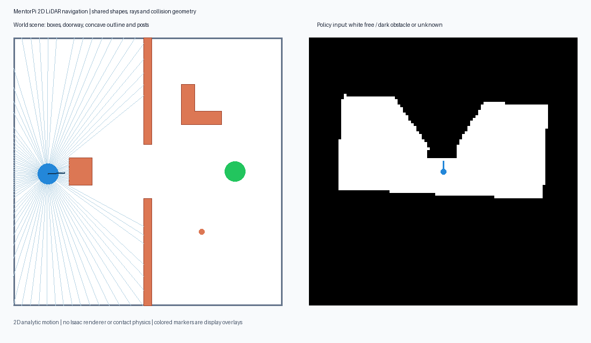
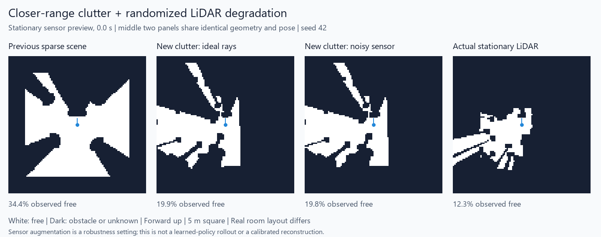

# LiDAR sim-to-real input improvements

The next implementation step is the [lightweight 2D navigation path](../../docs/planar.md),
which adds actual rectangles and concave polygons shared by LiDAR, collisions,
the teacher and both environment adapters. The animation below records the
earlier circle-union experiment; it is retained as historical comparison.



This still is an implementation preview with random-action smoke stepping,
not a learned-policy success demonstration. The box and walls have straight
edges; the L-shaped obstacle is a concave polygon. The raycast and collision
geometry use these exact outlines.

This example compares simulated occupancy inputs with a stationary capture from
the real MentorPi M1. It demonstrates a perception change, not improved policy
success or a completed retraining experiment.



[Still image](comparison.png) · [Preview measurements](summary.json)

## Reading the comparison

From left to right:

1. **Previous sparse scene:** the earlier simulated LiDAR example, with modest
   independent noise and dropout.
2. **New clutter, ideal rays:** thin posts and uneven compound obstacle outlines,
   viewed through first-return LiDAR without sensor degradation.
3. **New clutter, noisy sensor:** exactly the same geometry and robot pose as
   panel 2, with randomized sensor degradation enabled.
4. **Actual stationary LiDAR:** the robot on the floor with a box approximately
   one foot in front, captured November 14, 2026.

White is observed free space. Dark cells are either obstacles or unobserved
space. The blue robot marker and direction indicator are display overlays.
Each body-aligned grid is 100 × 100 cells at 5 cm per cell; forward is up and
left is robot-left. The actor still receives one binary occupancy channel plus
the existing eight state values. Separate hit/free policy channels have not
been implemented in this example.

The middle panels use training sampler seed 42. The stationary robot's yaw is
oriented toward the nearest obstacle for illustration. They contain 56 circle
pieces, with the nearest surface about 0.336 m from the robot center. The
previous scene and real room have different geometry. This is a comparison of
observation structure, not a reconstruction of the captured room.

## What changed

**Scene randomization:** 36–64 circle pieces form thin posts, short uneven faces,
and compound patches. Starts are sampled 0.3–0.7 m from the nearest obstacle
surface while retaining a reachable goal. The pieces are shared by collision
checking, the training teacher, and the simulated sensor.

**Sensor randomization:** each episode samples Gaussian range standard deviation
from 3–12 mm and independent ray dropout from 3–10%. Three persistent blind
sectors, each 1–5 degrees wide, are sampled at reset. Each scan also perturbs 1%
of ranges by a uniform signed error up to 8 cm. This preview's sampled standard
deviation is 7.29 mm and independent dropout probability is 9.69%.

**Shared input processing:** nominally 500 raw rays are normalized to 720 rays
using the runtime's conservative minimum-of-neighbors rule. Observed rays clear
space; first-hit returns receive the same one-cell endpoint uncertainty as on
the robot. Unknown cells remain blocked. The sensor uses the captured mounting
offset and updates at 10 Hz, with observations held between scans.

Most spatial irregularity comes from nearby geometry and occlusion. Sensor
degradation adds boundary variation and missing observations; noise is applied
to ranges before grid construction, not painted onto the grid.

## Run the scenarios

Use the configured Isaac Lab environment, from the repository root. Scenario
files are the authoritative settings; this folder does not duplicate them.

```bash
# Earlier LiDAR scenario for comparison.
python -m mentorpi_nav.cli.simulation --mode smoke --scenario-file scenarios/robot_lidar.json --num-envs 4 --steps 100 --log-dir logs/lidar_smoke --visualizer none

# New clutter and stronger sensor randomization.
python -m mentorpi_nav.cli.simulation --mode smoke --scenario-file scenarios/robot_lidar_clutter.json --num-envs 4 --steps 100 --log-dir logs/lidar_clutter_smoke --visualizer none
```

These commands exercise the scenarios and save occupancy previews; they do not
recreate this four-panel animation or replay the hardware capture. Raw hardware
recordings remain local and are not included. The embedded animation is the
saved comparison artifact. A smoke run uses random actions, not a trained actor.

- [Earlier LiDAR settings](../../scenarios/robot_lidar.json)
- [Clutter and randomized sensor settings](../../scenarios/robot_lidar_clutter.json)
- [Sensor implementation](../../mentorpi_nav/lidar.py)
- [Training and evaluation guide](../../docs/simulation.md)

## Evidence and limits

At implementation, all 72 tests passed and the new scenario completed a
100-step, four-environment Isaac Lab GPU smoke run. Separately, the Torch grid
builder matched the robot's NumPy builder cell-for-cell on all 241 normalized
scans from the stable hardware take. That validates grid conversion, not the
physical accuracy of synthetic returns.

The hardware take lasted approximately 25 seconds; motion-enable remained
false and applied velocity stayed zero. The animation compares the first
approximately 10 seconds of normalized scans with a stationary simulation.
The Pi's wall clock was inaccurate; the capture date comes from the operator
session.

The sensor augmentation ranges are robustness settings, not a fitted optical
or material-response model. Timing jitter, motion distortion, and the captured
498–501 raw-ray count variation are not modeled. The measurements in
`summary.json` describe this selected preview, not aggregate evaluation or
hardware benchmarks. No policy retraining or robot deployment is claimed.
